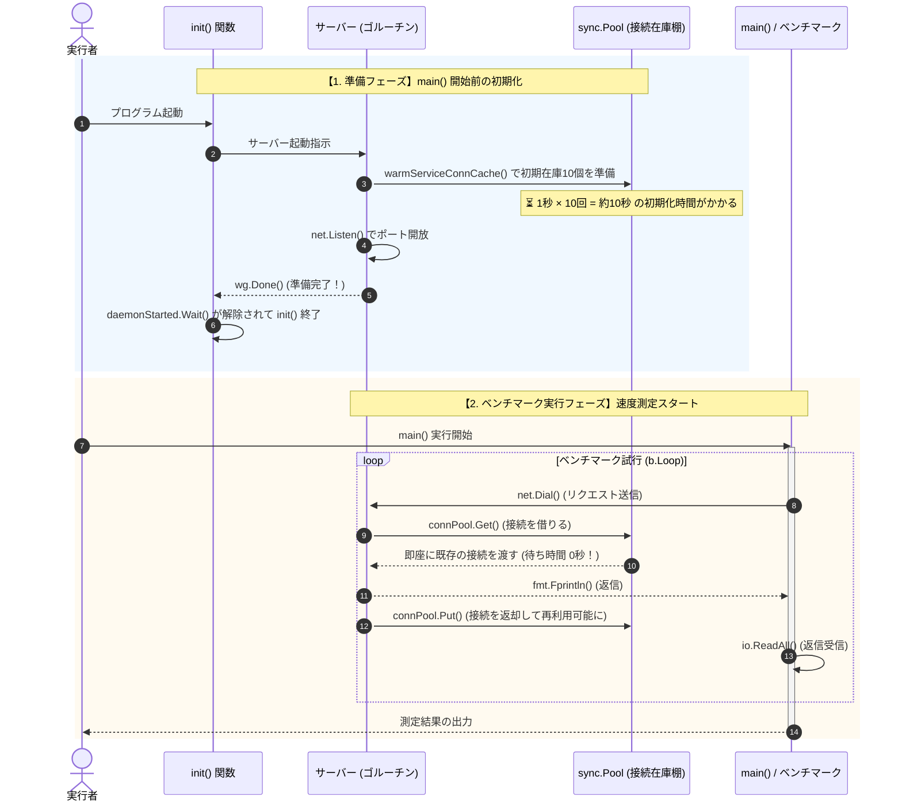

こんにちは！並行処理の学習をコツコツ進めています💻
今回は、書籍『Go言語による並行処理』を読んでいて思わず「おぉ〜！」と声が出た、**`sync.Pool` による接続プーリングの高速化検証** についてまとめました！

重い外部リソースへの接続を使い回すだけで、なんと**約470倍もの高速化＆約3,150倍のスループット向上**を叩き出した驚きの結果をシェアします✨

---

## 1. 今回の検証シナリオ（なぜプールが必要か？）🤔

* **想定シナリオ**:
  クライアントからリクエストが来るたびに、外部サービス（DBなど）への「重い接続（1秒かかる処理）」を行い、レスポンスを返すTCPサーバー。
* **直面する課題**:
  毎回律儀に新しい接続を作っていると、リクエスト1件ごとに1秒待たされて激遅になります🐢
* **解決策**:
  `sync.Pool` を使って、あらかじめ接続をプール（在庫保管）しておき、リクエストが来たらそれを使い回します！⚡

---

## 2. 改善前と改善後のコード比較👀

実際にどんなコードを書いたのか、ビフォーアフターで見てみます。

### 【改善前】毎回新規接続を作る（激遅コード🐢）

```go
func startNetworkDaemon() *sync.WaitGroup {
	var wg sync.WaitGroup
	wg.Add(1)
	go func() {
		server, err := net.Listen("tcp", "localhost:8080")
		// ... エラーハンドリング等 ...
		wg.Done()

		for {
			conn, err := server.Accept()
			// ...
			connectToService() // 🐢 毎回 1秒 待たされる！
			fmt.Fprintln(conn, "")
			conn.Close()
		}
	}()
	return &wg
}
```

リクエストのたびに `connectToService()` が走り、1秒間ガッツリ待たされます。

---

### 【改善後】`sync.Pool` で接続を使い回す（爆速コード⚡）

```go
// 1. プールを作成し、初期在庫（10個）を準備しておく関数
func warmServiceConnCache() *sync.Pool {
	p := &sync.Pool{
		New: connectToService, // 在庫切れの時は 1秒かけて新しく作る
	}
	for i := 0; i < 10; i++ {
		p.Put(p.New()) // 初期在庫（10個）を先行して作っておく（キャッシュウォーミング）
	}
	return p
}

func startNetworkDaemon() *sync.WaitGroup {
	var wg sync.WaitGroup
	wg.Add(1)
	go func() {
		connPool := warmServiceConnCache() // プールを準備！

		server, err := net.Listen("tcp", "localhost:8080")
		// ... エラーハンドリング等 ...
		wg.Done()

		for {
			conn, err := server.Accept()
			// ...
			svcConn := connPool.Get() // ⚡ 在庫から借りる（待ち時間ゼロ！）
			fmt.Fprintln(conn, "")
			connPool.Put(svcConn)    // ⚡ 使い終わったら返却（次で再利用！）
			conn.Close()
		}
	}()
	return &wg
}
```

### 💡 改善のポイント
1. **`warmServiceConnCache()` の導入**:
   あらかじめ10個の接続を生成して `sync.Pool` に保管（キャッシュウォーミング）しておきます。
2. **`Get()` と `Put()` の活用**:
   リクエストが来たら `connPool.Get()` で即座に既存の接続を借りて、使い終わったら `connPool.Put(svcConn)` でプールに戻します。

---

## 3. 処理の流れを図解で理解する🎨

「起動時の準備」と「リクエスト時の再利用」の流れをシーケンス図にまとめました。



---

## 4. ベンチマーク測定結果：驚きの数字！📊

Goのベンチマーク機能を使って比較した結果がこちらです：

| 項目 | 改善前（Pool なし） | 改善後（Pool あり） | 改善効果 |
| :--- | :--- | :--- | :--- |
| **実行ログ** | `1    1001913291 ns/op` | `3154    2129529 ns/op` | - |
| **目標時間（約1秒）内に処理できた回数** | **1 回** | **3,154 回** | **約 3,150 倍のスループット向上！** 🚀 |
| **1リクエストあたりの平均時間** | **約 1,002 ms** (1.002秒) | **約 2.1 ms** (0.0021秒) | **約 470 倍の高速化！** 🔥 |

1秒間に「1回」しか処理できなかったのが、なんと**「3,154回」**も処理できるようになりました！

### 補足：なぜ 2.1 ミリ秒 残るの？
接続作成にかかる1秒間の待ち時間は完全にゼロになりましたが、TCPソケット通信自体のオーバーヘッド（パケットの送受信や切断など）の物理的な所要時間が約 2.1 ms として残るためです。

---

## 5. 初心者が疑問に思ったQ&A集🐣

コードを読み解く中で気になったポイントをQ&A形式でまとめておきます！

### Q1. 起動時に約10秒待たされるのは問題ないの？
**A.** **実用的なトレードオフです！**
10個の接続を1秒ずつかけて事前準備するため、起動時に約10秒の先行投資が発生します。しかし、一度起動してしまえばその後の大量リクエストを待ち時間ゼロで捌けるようになるため、Webサーバーなどでは非常に有効なアプローチです。

### Q2. `warmServiceConnCache` の戻り値がポインタなのはなぜ？
**A.** **サーバー全体で「たった1つの同じ在庫棚」を共有するためです。**
もしポインタでなく値渡し（コピー）にしてしまうと、ゴルーチンごとに別々のプール（パラレルワールド）を参照してしまい、せっかくのキャッシュが使い回せなくなってしまいます。

### Q3. `wg.Done()` を呼んだらゴルーチンは終了しちゃう？
**A.** **終了しません！**
`wg.Done()` はゴルーチンを終了する命令ではなく、「カウンターを1減らす（完了を知らせる）」だけの命令です。待機していた側の `Wait()` が解除された後も、サーバーゴルーチンはそのまま次の `for` ループに進んでリクエストを待ち続けます。

---

## まとめ📝
前回の記事で紹介した「メモリ領域の再利用」だけでなく、今回のように「重いネットワーク接続の再利用」にも `sync.Pool` は絶大な威力を発揮することがよく分かりました！

並行処理の世界、知れば知るほど面白いですね〜！次回も学んだ知見をどんどん発信していきます💪
最後まで読んでいただきありがとうございました！
